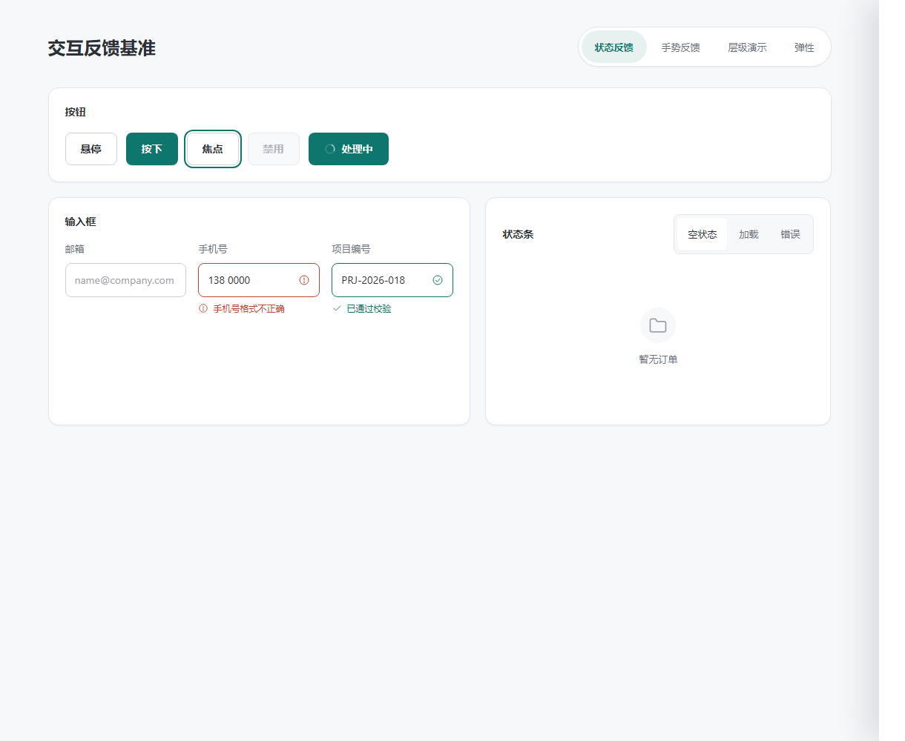
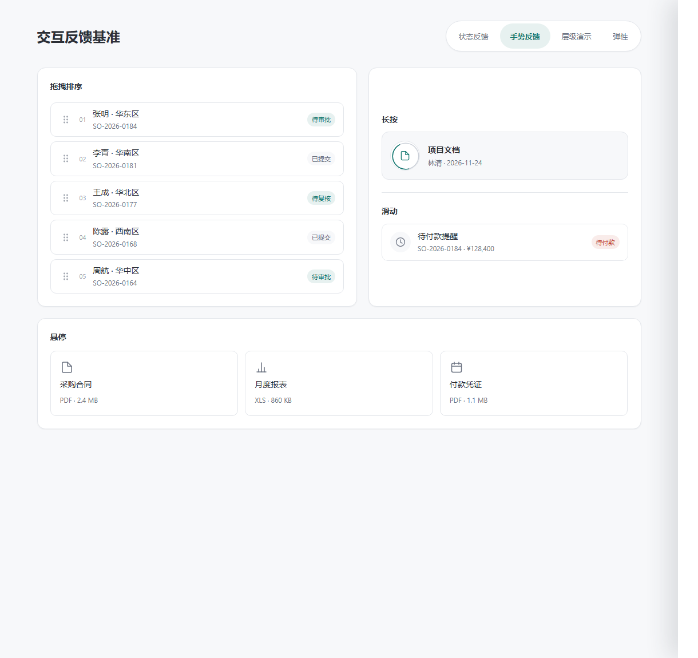
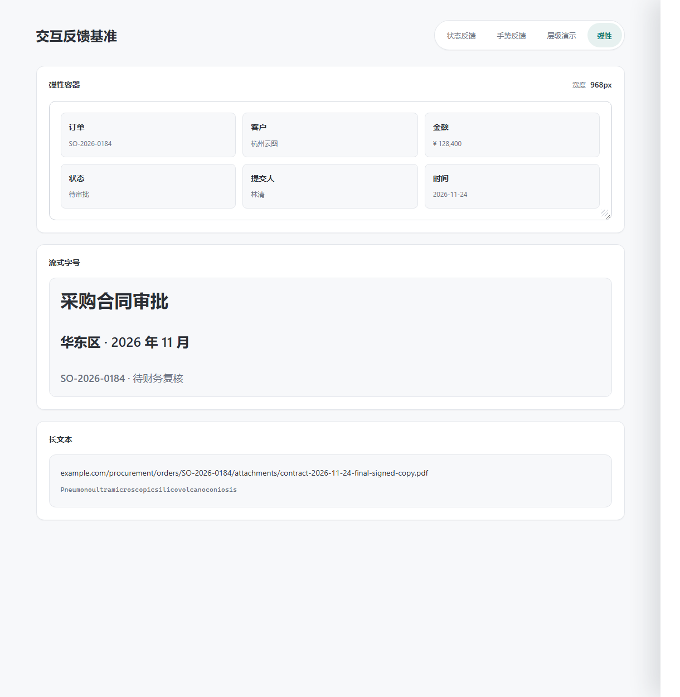

# 前端 UI 开发规范（Agent Skill）

给 AI 编码助手用的一套可执行前端 UI 规范。**五条硬禁令 + 三条加分项 + 六道交付闸门**，写完页面必须过检。

不是设计灵感合集，是判定标准：每条都能被脚本查、被评审引用、被交付前逐条打勾。



## 它解决什么

AI 生成的界面有四个通病，这份规范逐条堵住：

- 主色永远是黑 / 紫 / 深蓝，一眼模板感；
- 页面上写满「该字段不可修改」「本功能支持…」这类功能说明，挤掉操作空间；
- 用 emoji 当图标，跨平台字形不一致、对齐全乱；
- 把列表、详情、编辑、统计全堆一屏，靠分割线分层。

另加两条同样常见的问题：**写死固定尺寸**（125% 缩放下横向滚动）、**交互没有反馈**（点下去没有任何状态变化）。

## 五条禁令

| # | 禁令 | 判定方式 |
| --- | --- | --- |
| 1 | 主色禁用黑 / 紫 / 深蓝 | HSL 阈值：近黑 S<10 且 L<12；紫 H236–305 且 S≥30；深蓝 H195–250 且 L<45；另含伪中性 slate `#0F172A` |
| 2 | 页面禁功能说明性备注 | 行动影响测试三问，全否即删；只允许七类提醒（后果 / 不可逆 / 前置 / 时效 / 冲突 / 权限 / 合规） |
| 3 | 禁 emoji | 码位区间 `1F300–1FAFF`、`2600–27BF`、`2B00–2BFF`、`FE0F`，含 `&#128640;` 这类实体写法 |
| 4 | 禁一页面板式 | 一屏同级区块 ≤ 3；列表 / 详情 / 编辑 / 说明必须分层 |
| 5 | 禁写死固定尺寸 | 无固定宽高与 px 字号；Windows 缩放 125% / 150% / 200% 与 365px 窄屏四测通过 |

白名单（这些写死是对的）：`1px` 边框、圆角、阴影、动效时长、图标 16/20/24、触控热区下限 `min-height: 44px`。

## 三条加分项

- **真实交互反馈**：hover / press / focus-visible / disabled / loading / success / error / empty 八态；拖拽、滑动、长按、右键都给了可复制实现与键盘等价。
- **分层组织信息**：Tab / 弹窗 / 抽屉 / 菜单 / 多级页面 / 步骤条的选型决策表，信息类型放哪一层有明确对应。
- **自绘 SVG 图标**：46 个内联图标，24 栅格、1.5 描边、`currentColor`，直接复制可用。

## 六道交付闸门

主色与视觉 → 文案 → 结构 → 交互 → 图标 → 弹性尺寸。逐条打勾，再跑脚本：

```powershell
$h = [IO.File]::ReadAllText((Resolve-Path .\index.html), [Text.Encoding]::UTF8)

# 全部应为 0
[regex]::Matches($h, '[\uD800-\uDBFF][\uDC00-\uDFFF]|[\u2600-\u27BF\u2B00-\u2BFF\uFE0F]').Count            # emoji
[regex]::Matches($h, '注：|说明：|温馨提示|系统自动生成|不可修改|该字段').Count                                  # 说明性文案
[regex]::Matches($h, '(?i)#(?:000000|7c3aed|8b5cf6|6366f1|1e3a8a|1d4ed8|0f172a|111827)').Count              # 禁用主色
[regex]::Matches($h, '(?<![a-z-])(?:width|height)\s*:\s*[0-9]{2,}px|font-size\s*:\s*[0-9]+px|100vh|100vw').Count  # 固定尺寸
```

结构性判断（主任务是否唯一、层级是否错位）脚本查不出，必须人工数——这部分规则在 `references/04` 与 `references/06` 里。

## 目录结构

```
SKILL.md                        # 主干：禁令 + 加分项 + 自检闸门（Agent 加载入口）
references/
  01-色彩与主色合规.md           # HSL 判定、6 个安全主色（含实测对比度）、深色模式
  02-文案与信息层级.md           # 禁写 / 可写清单、字段帮助与提醒的区分、改法对照
  03-交互与反馈.md               # 八态、拖拽 / 滑动 / 长按实现、无障碍降级
  04-信息架构与页面分层.md       # 七层阶梯、信息分派表、组件选型、拆分对照
  05-图标与SVG规范.md            # 几何硬指标、尺寸档、四态、10 条禁止
  06-交付自检.md                 # 六道闸门 + 自动化脚本 + 反例对照
  07-弹性尺寸与缩放适配.md       # 白名单、四个缩放测试、flex/grid 撑破坑、Windows 专项
assets/
  design-tokens.css             # 三层 token + 流式字号 + 容器查询断点
  icons.md                      # 46 个内联 SVG 图标
  interaction-demo.html         # 单文件 demo：4 个 Tab，可直接打开摸手感
docs/                           # README 预览图
```



## 安装

仓库根目录就是 skill 目录，clone 下来放进对应位置即可。

**DeepSeek Harness（DSH）**

```bash
git clone https://github.com/Trouvaille-xx/frontend-ui-standards.git ~/.dsh/skills/frontend-ui-standards
```

**Claude Code / 其他支持 Agent Skills 的工具**

```bash
git clone https://github.com/Trouvaille-xx/frontend-ui-standards.git ~/.claude/skills/frontend-ui-standards
```

Windows 路径示例：`C:\Users\<you>\.dsh\skills\frontend-ui-standards`。

装好后技能列表里会出现 `frontend-ui-standards`，写页面前会自动加载。

## 怎么触发

触发靠 `SKILL.md` 的 description，下面这些请求都会命中：

- 「做一个供应商商品维护页面」
- 「把这个原型改成能看的」
- 「这个页面太乱了，重新设计信息层级」
- 「用 frontend-ui-standards 检查这个文件」（评审模式，出整改清单）

## 两个设计取舍

**为什么给固定值白名单。** 只说「不要用固定值」没法执行——`1px` 边框、圆角、图标尺寸本来就该写死。所以规范明确列出允许固定的六类，其余一律弹性，脚本才能判定。

**为什么禁令要能自动化。** 能被正则查出来的规则才会真的被执行。emoji、禁用色、说明性文案、固定尺寸都有对应的检查片段；查不出的（层级、主任务唯一性）明确标注为人工过闸。



## 适配范围

- 窄屏：390px 下 4 个 Tab 单行放得下，列表行改为三行网格，抽屉与弹窗不越界，见 `docs/preview-narrow.png`。
- Windows 缩放：125% / 150% / 200% 实测无横向滚动，`scrollWidth ≤ clientWidth`。
- 无障碍：键盘可完成拖拽排序，弹窗与抽屉有焦点陷阱与焦点归还，`prefers-reduced-motion` 有降级。

## License

MIT，见 [LICENSE](LICENSE)。
